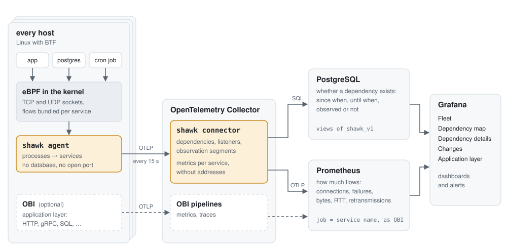
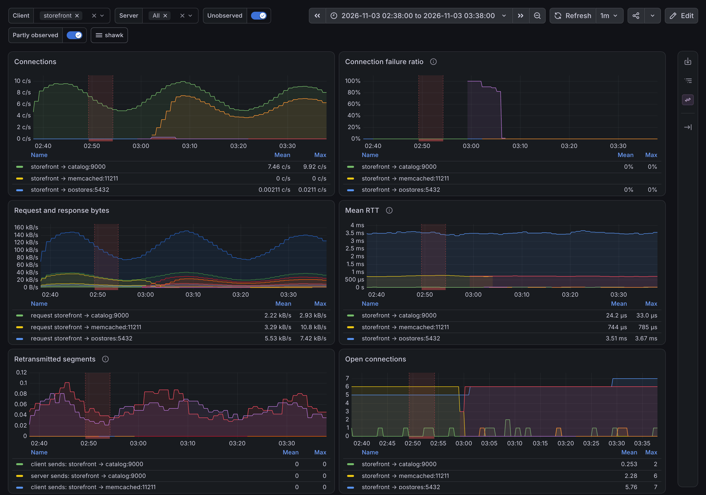
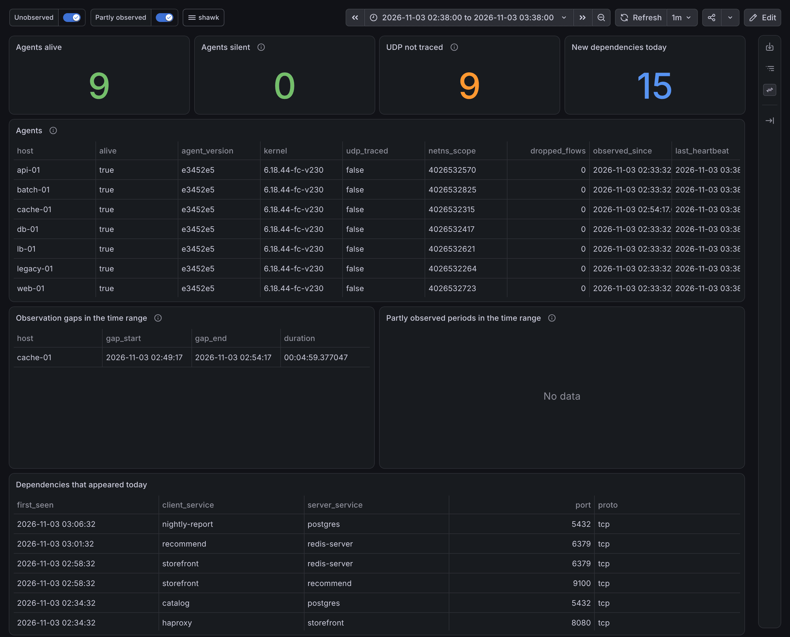
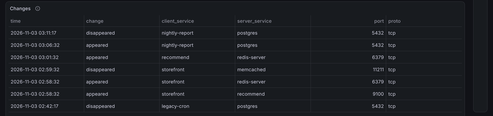

# shawk

shawk records the network dependencies of your servers: which process talks
to which TCP/UDP service on every host, or to which local service on its
Unix socket, since when, until when, and how much.
It traces sockets in the kernel with eBPF, keeps the dependencies in
PostgreSQL, sends their traffic to Prometheus and shows both in Grafana.

It is meant for the questions you ask before changing a system: *who still
uses this database? what appeared after the deployment? did anything use
this host in the last 90 days, and were we watching?*

- Every process is covered without instrumentation, whatever its language
  or protocol, cron jobs and third-party software included.
- Flows to the same service are bundled in the kernel and TCP is traced only
  at connection state changes, so the agent can always run and does not
  sample: a job that runs once a month is still seen.
- Each host's observation periods and the periods its agent dropped flows
  are recorded, so "not used" can be told apart from "not observed".
- TCP and UDP sockets are observed, and the connections of Unix stream
  sockets (a local PostgreSQL, php-fpm, Docker, munge), without their
  traffic; so "not used" means "no TCP, UDP or Unix stream connection".
  Datagram Unix sockets (syslog, journald) are not traced. RDMA verbs
  (InfiniBand, RoCE) bypass the sockets: the RDMA
  transports of MPI (UCX) and NCCL, Lustre o2ib, GPFS verbs and NFS over
  RDMA are not seen, even when their control connections over TCP are; TCP
  over IPoIB is. See [packaging/README.md](packaging/README.md#hpc-clusters)
  for HPC clusters.
- Agents send OTLP to an OpenTelemetry Collector. Services are named the
  way OBI (OpenTelemetry eBPF Instrumentation) names them, so shawk's
  dependencies and OBI's application metrics share the same `job`.

The tracing method is from [Low Overhead TCP/UDP Socket-based Tracing for
Discovering Network Services
Dependencies](https://yuuk.io/papers/transtracer_jip2022.pdf) (JIP, 2022).
The design is in [docs/design.md](docs/design.md).

<picture>
  <source media="(prefers-color-scheme: dark)" srcset="docs/images/architecture-dark.svg">
  
</picture>

| component | role |
|---|---|
| `shawk agent` | runs on every host; sends its dependencies as OTLP metrics every 15 s; no database, no open port |
| shawk connector | an OpenTelemetry Collector component; writes PostgreSQL, names the peer of every dependency, forwards metrics without addresses to Prometheus |
| PostgreSQL | whether a dependency exists and when (views of the schema `shawk_v1`) |
| Prometheus | how much flows: connections, failures, bytes, RTT, connect time, retransmissions |
| Grafana | dashboards and alerts |

## Requirements

- Linux with BTF (`/sys/kernel/btf/vmlinux`): RHEL / Rocky Linux 9, or
  upstream 5.14 or later. Unix sockets need BPF trampolines (fentry,
  fexit), which arm64 has only since 6.0 (Rocky Linux 9.8); without them
  they are not traced, and UDP is traced with kprobes, at about twice the
  cost per datagram. The tested kernels
  are listed in
  [design §3.5](docs/design.md#35-kernel-requirements-and-features-used).
  The agent runs as root with the capabilities that
  [its systemd unit](packaging/systemd/shawk-agent.service) grants.
- PostgreSQL 14 or later.
- Prometheus 3 with `--web.enable-otlp-receiver`, or another store that
  accepts OTLP metrics.
- Grafana.

## Install

### Agent

The deb and rpm packages `shawk` install `/usr/bin/shawk` and
`shawk-agent.service`; set the collector in `/etc/shawk/agent.env`. From a
release tarball or a build (`make build`, needs Go only):

```bash
sudo install -m 0755 shawk /usr/local/bin/shawk
sed 's|/usr/bin/shawk|/usr/local/bin/shawk|' packaging/systemd/shawk-agent.service |
  sudo tee /etc/systemd/system/shawk-agent.service >/dev/null
sudo install -D -m 0644 packaging/systemd/agent.env /etc/shawk/agent.env
sudo systemctl daemon-reload
sudo systemctl enable --now shawk-agent
```

The unit is `Type=notify`: it becomes active once the BPF programs are
attached, and fails if they cannot be. Order the services whose first
connections should be traced after it, e.g. slurmd
([packaging/](packaging/README.md#agent)).

`shawk agent -h` lists the flags. Most deployments set only
`-otlp-endpoint` and the TLS files (`-otlp-ca-file`, `-otlp-cert-file`,
`-otlp-key-file`). Services that share an executable on a host (`ruby`,
`python`, `java`) should set `OTEL_SERVICE_NAME`, e.g. with `Environment=`
in a systemd drop-in, as for OBI.

### Collector

A release ships an OpenTelemetry Collector that includes the connector:
the deb and rpm packages `shawk-collector` (with `shawk-migrate` and the
PostgreSQL scripts) and the image `ghcr.io/yuuki/shawk-collector`. To build
it yourself, run `make collector shawk-migrate`.

[packaging/](packaging/README.md) has the configuration of the collector,
PostgreSQL, Prometheus and Grafana, and the steps to set them up. A
database created by v0.8.0 must be created again; see the
[CHANGELOG](CHANGELOG.md).

Connections through a load balancer, a virtual address or a proxy without
an agent end at its address unless the translation is known: agents learn
the translations of their own host from conntrack (Docker, kube-proxy,
IPVS, NAT rules), and the others can be configured in the connector
([design §5.4](docs/design.md#54-translations-of-addresses)).

## Usage

The Grafana dashboards:

- **Fleet**: agents alive, observation gaps, dropped flows, new dependencies.
- **Dependency map**: services upstream and downstream of the selected ones.
- **Dependency details**: traffic, failures by reason, RTT and connect time
  of each dependency, with its first and last seen times.
- **Peer hosts**: with `peer_hosts` in the connector, the hosts towards
  the selected services, and failures and connect time by peer host; with
  `networks`, the networks the connections use.
- **Changes**: dependencies that appeared or disappeared.
- **Application layer (OBI)**: OBI's RED metrics next to the dependencies of
  the same service.

The screenshots are of a demo of nine hosts over an hour in which
`storefront` was deployed to use `redis-server` instead of `memcached` and a
new `recommend` service, and the agent of `cache-01` stopped for a few
minutes.




<details>
<summary>Fleet and Changes</summary>





</details>

In SQL:

```sql
-- Who used postgres on db-01 in the last 90 days, and were they observed?
SELECT client_host, client_service, port, last_seen, client_observed_until, observed_by
FROM shawk_v1.dependencies_between(now() - interval '90 days', now())
WHERE server_host = 'db-01' AND server_service = 'postgres';

-- When was db-01 not observed, or only partly?
SELECT * FROM shawk_v1.unobserved(now() - interval '90 days', now()) WHERE host = 'db-01';
SELECT * FROM shawk_v1.partly_observed(now() - interval '90 days', now()) WHERE host = 'db-01';
```

In PromQL, with the recording rules of `packaging/prometheus/`:

```promql
shawk:dependency_connections:rate5m{dst="postgres"}
shawk:dependency_connection_failures_by_reason:rate5m{dst="postgres", error_type="timeout"} > 0
```

`shawk flows` prints the bundled flows of the local host live, without a
collector.

## Development

```bash
make check         # lint, audit the workflows, tests with the race detector: before a pull request
make generate      # compile the BPF programs (clang, llvm-strip)
make vet test      # BPF tests need root; PostgreSQL tests need SHAWK_TEST_POSTGRES_DSN
make test-fuzz     # the fuzz targets, FUZZTIME each (30s)
make vm-test       # BPF tests in a VM: KERNEL=rocky9|5.14|5.15 ARCH=x86_64|aarch64
make e2e           # multi-host test (sudo, SHAWK_E2E_POSTGRES_DSN)
make complexity    # rank the most complex functions (needs cccc, see below)
```

The environments the tests need come up and go with one command each, on
macOS and Linux, per checkout or worktree (see
[test/harness](test/harness/README.md), which also lists the variables each
test reads):

```bash
make pg-up         # a disposable PostgreSQL; prints SHAWK_TEST_POSTGRES_DSN and SHAWK_E2E_POSTGRES_DSN
make pg-test       # the tests of the connector against it (make pg-down removes it)
make slurm-up      # a Slurm cluster in a VM of Lima: SLURM_VERSION=26.05.5 SLURM_CGROUP_JOB_ID_PATHS=no ...
make slurm-check   # run jobs and check the units of their processes (make slurm-down removes it)
```

The other targets are described in the [Makefile](Makefile); see
[CONTRIBUTING.md](CONTRIBUTING.md), [AGENTS.md](AGENTS.md) and
[SECURITY.md](SECURITY.md). The compiled
BPF object is committed, so building needs only Go. There are three Go
modules: the agent (`.`), the connector (`collector/`, kept separate so the
agent does not depend on the collector) and the tests of `packaging/`
(`test/packaging/`).

[docs/proposals/](docs/proposals/) holds designs not implemented yet, and
[docs/research/](docs/research/README.md) background research that is not
maintained.

### Code complexity

CI measures Cognitive and Cyclomatic Complexity with
[cccc](https://github.com/moznion/cccc) on pull requests and pushes to `main`
(`.github/workflows/complexity.yml`) and tracks them with
[octocov](https://github.com/k1LoW/octocov) as custom metrics: the number of
functions and the total, maximum, median and 90th percentile of each score. A
pull request gets a comment comparing them with `main`, each push to `main`
stores a report in the `octocov` branch, and the job summary ranks the 20 most
complex functions. Nothing fails on a score: the numbers point at hotspots and
show trends, such as a component taking on too much, instead of being a target.
`cccc.toml` lists what is not analyzed, such as tests and generated or vendored
code; the BPF programs are left out because the verifier constrains how they
can be split. To check locally, install cccc (a [release
binary](https://github.com/moznion/cccc/releases) or `cargo install cccc-cli`)
and run `make complexity`, which ranks the most complex functions.

## History

shawk started as *Transtracer*
([IOTS 2019](https://yuuk.io/papers/transtracer_iots2019.pdf)) and was
rewritten from scratch in 2026.

## License

[Apache License 2.0](LICENSE). The eBPF programs
(`internal/tracer/bpf/shawk.bpf.c`, `shawk.h`) are dual-licensed
[GPL-2.0-only](LICENSES/GPL-2.0-only.txt) OR
[BSD-2-Clause](LICENSES/BSD-2-Clause.txt), because the kernel loads only
GPL-compatible programs and the compiled object ships in the Apache-2.0
binary. See [NOTICE](NOTICE) for the bundled third-party files.
